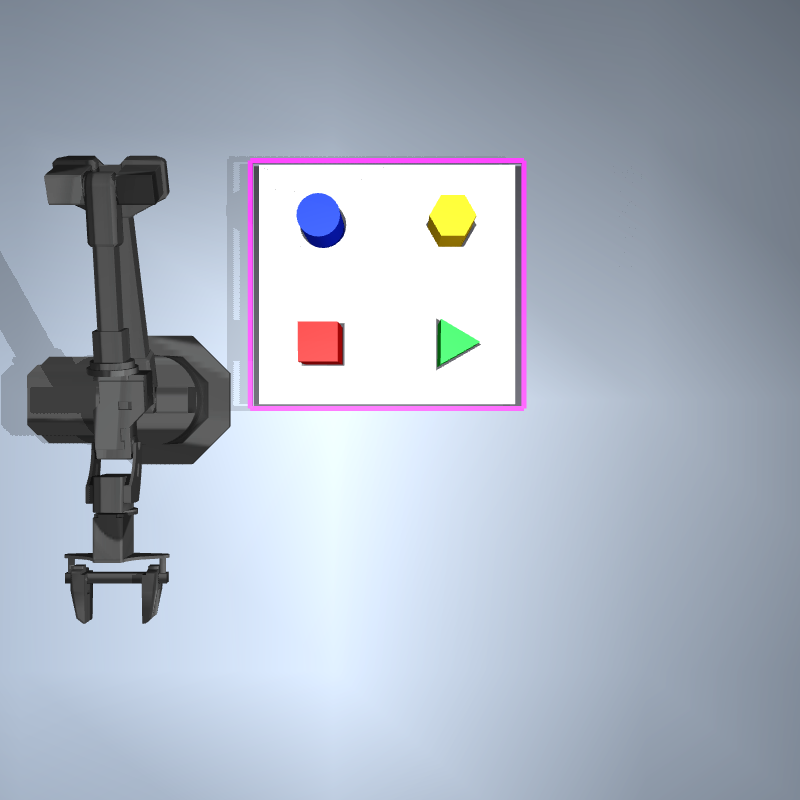

# Tri-Wizard Peg Trial

Autonomous, vision-guided sorting of four colored pegs with the **Interbotix WidowX-250S 6DOF** in MuJoCo. This is a simulation-only assignment: no robot hardware, physical cameras, ROS, Gazebo, MoveIt, or trained neural network is required.



## Verified status

Tested on Ubuntu 22.04.4 x86-64, **Python 3.10.12**, **MuJoCo 3.3.5**, NumPy 2.2.6, SciPy 1.15.3, OpenCV 4.11.0, and PyYAML 6.0.2. Dependency distributions are pinned in `requirements.txt`; the complete installed dependency set is in `requirements-lock.txt`.

With the faster continuous-motion controller, five actual autonomous trials, seeds 0–4, produced **20/20 verified placements and 5/5 complete trials**, all on the first grasp/placement attempt. Each trial detected and classified all four pegs and detected all four sockets. Mean initial top-face position error was **0.282 mm**; mean execution time was **90.206 simulated seconds**, or **22.552 simulated seconds per peg**. Mean headless wall time was **4.518 seconds** on this environment.

The original five-trial controller averaged **228.862 simulated seconds**. The updated controller is **2.54× faster**, reducing simulated execution time by **60.6%**, while retaining the same placement criteria. Wall time varies with rendering, recording, and machine load. These measurements describe this small, conservative simulation test set; they are not a general reliability estimate or a hardware claim.

Current measurements: [CSV](results/performance/trials.csv), [summary](results/performance/summary.json), and per-trial `episode.json` files under `results/performance/`. The original [CSV](results/evaluation/trials.csv) and [summary](results/evaluation/summary.json) remain as the historical baseline. Physical insertion, release, alignment, stability, overhead top-face height, and angled-camera height must all pass. Near-socket positions alone fail verification.

The automated suite currently contains **61 passing tests** (8.79 seconds in the latest run), including a complete autonomous episode, rendered camera calibration checks, physical socket tests, continuous-path derivative/limit checks, actual collision rejection, GUI refresh pacing, and interruption of active keyboard-commanded motion. Simulation, vision, and teleoperation GUI launchers were opened and closed successfully. A complete autonomous GUI run verified all four placements in **90.01 wall seconds** (89.894 simulated seconds). A GLFW Wayland window-position warning is harmless in this environment.

## Implemented features

- Four 10 cm high, 4–6 cm wide, 70 g free-body pegs: red square, green triangle, blue circle, yellow hexagon.
- Four matching physical apertures, with 3 mm clearance normal to polygon edges and a 28 mm insertion depth. Convex collision prisms surround each opening; a floor supports inserted pegs.
- Two independent calibrated RGB-D cameras plus an overview camera for recordings. RGB is `uint8`; depth is metric optical Z in meters.
- Configurable HSV segmentation with red hue wrapping, morphological cleanup, contours, centroids, and bounding boxes.
- Rotation-invariant polygon classification and regular-polygon boundary fitting for position/yaw estimation.
- Board detection from its magenta perimeter; socket shapes and centers from the observed depth discontinuities. No fixed pixel coordinates or stored socket XY positions enter perception or motion targets.
- Six-joint damped least-squares IK using the compiled model Jacobian and both position and orientation tolerances.
- Continuous joint curves through Cartesian IK waypoints, smooth quintic time progress, exact joint-limit checks, and sampled curve collision checks including the carried peg.
- Actuated gripper fingers with a **proximity/alignment-gated simulated weld attachment**, disclosed below.
- Autonomous pick, lift, transfer, align, insert, release, retreat, and two-camera/physical verification, with one bounded retry where recovery is safe.
- Keyboard teleoperation, simulation motion stop, seeded evaluation, CSV/JSON results, and real-run video recording.

## Quick setup

```bash
cd tri-wizard-peg-trial
python3 -m venv .venv
.venv/bin/python -m pip install -r requirements-lock.txt
.venv/bin/python -m pip install --no-build-isolation --no-deps -e .
.venv/bin/python -m pip check
```

The source checkout includes the licensed robot meshes. If they are missing, run `.venv/bin/python scripts/fetch_robot.py`. Downloads use a pinned upstream revision, and the script refuses to overwrite modified upstream files.

On Ubuntu, OpenGL/EGL libraries and a display are needed for GUI rendering. Headless validation uses Mesa EGL without an X server. See [setup](docs/setup.md) and [troubleshooting](docs/troubleshooting.md) for prerequisites. Keep the source checkout available; this project uses editable installation to locate `config/` and `simulation/`. `PEG_SORTING_ROOT` can explicitly select a checkout.

## Launch commands

From the repository root:

```bash
bash launch/run_simulation.sh
bash launch/run_vision.sh
bash launch/run_teleop.sh
bash launch/run_autonomy.sh
```

Simulation and teleoperation show the MuJoCo viewer. Vision, teleoperation, and autonomous GUI modes also show overhead/angled RGB and depth panels. Click the viewer or camera window to give it keyboard focus. Close the viewer to exit. GUI runs pace toward real time; actual speed depends on rendering performance.

Restart any simulation process that was already running before this update so it loads the faster controller. Live RGB-D panels refresh at most four times per wall-clock second by default; viewer synchronization runs independently at up to 30 Hz. On a slower machine, reduce panel work with:

```bash
bash launch/run_autonomy.sh --camera-fps 2
```

`--camera-fps` changes only live panel refresh. Autonomous perception captures and recording cadence remain independent.

For a display-independent autonomous run:

```bash
bash launch/run_autonomy.sh --headless --seed 0
bash launch/run_vision.sh --headless --seconds 1
bash launch/run_simulation.sh --headless --seconds 2
```

`--output PATH` selects an artifact directory; the default is a unique directory under `results/runs/`. Autonomous mode exits with status 0 only when all four placements pass. Pass `--seconds 2` to a simulation/vision/teleop GUI launcher for a bounded smoke run. Teleoperation requires a GUI.

## Keyboard controls

| Key | Action |
| --- | --- |
| W / S | World +X / −X, 1 cm per command |
| A / D | World +Y / −Y, 1 cm per command |
| R / F | World +Z / −Z, 1 cm per command |
| O / C | Open / locally gated close |
| P | Automatically pick the nearest visually detected peg |
| L | Insert the peg picked with P into its visible matching socket |
| Space | Stop commanded simulation motion and hold current joint positions |
| Q | Quit |

Workspace bounds, IK, joint limits, and collision checks also apply to teleoperation. Space is a simulation stop command. It is not a physical hardware emergency stop. The P/L macros require unoccluded perception; rejected commands print a reason.

## Robot provenance and validation

The required `wx250s` was integrated without substituting another robot. The vendored model is the [MuJoCo Menagerie WidowX-250S description](https://github.com/google-deepmind/mujoco_menagerie/tree/f3b6013629c7b94f8ee93fd977b161fa8350f9bc/trossen_wx250s), derived upstream from [Interbotix's URDF](https://github.com/Interbotix/interbotix_ros_manipulators/blob/main/interbotix_ros_xsarms/interbotix_xsarm_descriptions/urdf/wx250s.urdf.xacro). Its BSD-3-Clause license, original conversion notes, immutable revision, and SHA-256 file hashes are retained under `simulation/robots/wx250s/`.

The zero-pose official TCP is verified at **(0.458325, 0, 0.36065) m**, and all six joint ranges match the [manufacturer's limits](https://docs.trossenrobotics.com/interbotix_xsarms_docs/specifications/wx250s.html). The official TCP offset is `0.043 + 0.023 + 0.027575 = 0.093575 m` from `gripper_link`. A separate grasp site at 0.108 m comes from the upstream finger contact locations. Body geometry, link transforms, masses, and inertias are retained. Servo gains and feed-forward bias compensation are simulation control choices, not validated physical servo parameters. Details are in [robot integration](simulation/robots/README.md).

## Architecture and repository

```text
config/                    Colors, robot, cameras, planning, physics
src/peg_sorting/
  simulation/              MJCF generation, MuJoCo dynamics, RGB-D cameras
  vision/                  Segmentation, shape, pose, socket detection, overlays
  planning/                Full-pose IK, grasp/placement waypoints, collision checks
  control/                 Arm/gripper control, autonomy, keyboard teleoperation
  utils/                   Transforms, configuration, CSV/JSON output
simulation/
  scenes/peg_sorting.xml    Portable nominal MJCF, seed 0
  robots/wx250s/           Licensed upstream MJCF and meshes
  objects/                 Standalone peg and socket-board MJCFs
launch/                    Virtual-environment-aware executable launchers
scripts/                   Scene generation, evaluation, detection capture
tests/                     Unit and marked simulation integration tests
results/performance/       Current faster-controller trials, screenshots, CSV, JSON
results/evaluation/        Preserved original-controller measurements
docs/                      Setup, architecture, demo, troubleshooting, validation
```

The CLI builds a seeded scene in memory from YAML configuration, preserving the nominal XML on disk. Regenerate the portable scene and standalone assets with `.venv/bin/python scripts/generate_demo_scene.py --seed 0`. The portable scene and all five object XMLs have been compiled separately by MuJoCo.

The complete list of created source, model, documentation, and measured-result files is in [the file inventory](docs/file_inventory.md).

## Cameras and perception

`config/cameras.yaml` controls both cameras' poses, field of view, and 800×800 image dimensions. `config/camera_calib.yaml` documents conventions. Intrinsics use vertical FOV and half-pixel centers. Extrinsics come from the compiled cameras. OpenCV x-right/y-down/z-forward coordinates are transformed to MuJoCo x-right/y-up/z-backward coordinates.

MuJoCo 3.3.5's `Renderer.render()` already returns metric depth and top-left image orientation. The interface does not convert or flip it again. A separate tested helper handles low-level normalized OpenGL buffers. Tests reconstruct known tabletop points from **both actual rendered depth streams**, checking depth and world coordinates.

Edit HSV ranges and rendered RGBA colors in `config/colors.yaml`. Classification uses contour vertices, rotated rectangle aspect ratio, and circularity. Depth isolates the top face before shape/pose estimation. Boundary fitting uses every contour pixel so a compressed horizontal edge cannot bias a triangle's center. Socket detection estimates the board rim plane from depth and backprojects the aperture boundary onto it. The magenta perimeter is an intentional visual board marker.

Ground-truth peg poses are used only for evaluation, local grasp capture checks, and collision geometry. They do not supply peg/socket navigation targets. Socket floor depth and known peg height are fixture dimensions. The angled camera supplies independent depth-based placement verification and grasp visibility.

## Motion and grasp assumptions

The arm uses the real model's forward kinematics and Jacobian. IK accepts a target only when both errors meet the configured tolerances. Cartesian motions retain **8 mm IK nodes**, then fit a continuous cubic joint curve and apply one quintic time-progress function over the whole motion. The arm starts and stops once per complete approach/lift/retreat rather than stopping at every IK node. Exact piecewise-cubic derivative bounds set durations that respect **1.2 rad/s** and **2.8 rad/s²** command limits. Joint-position extrema are checked explicitly to catch spline overshoot; collision checks sample the actual curve at bounded joint increments of at most 0.025 rad.

Endpoint settling is adaptive, from **0.04 to 0.25 seconds**, and must finish below the arm velocity threshold. General Cartesian approaches use **0.09 m/s**. Only the final **socket depth + 15 mm** of lowering uses the slower **0.035 m/s** insertion setting. This removes the previous repeated 0.25-second waits at every Cartesian node while preserving the insertion stage and collision checks. This is a sampled conservative planner, not a globally complete planner or continuous swept-volume guarantee.

The gripper actuates both coupled fingers. A weld may activate only within **9 mm** of the peg's grasp region, with an upright peg, downward tool, sufficiently small arm velocity, and a compatible aperture. The weld preserves the current relative pose; it does not reposition the peg. It is disabled on release, after which gravity and collisions determine the seated pose. **This demonstrates vision-guided manipulation with an assisted simulation grasp, not validated friction-only grasping.** No runtime transport code writes peg `qpos`. Controlled state assignment appears only in initial scene construction, scratch collision-planning data, and explicit physical-fixture tests.

## Tests and evaluation

```bash
.venv/bin/pytest -q
.venv/bin/pytest -q -m 'not integration'
.venv/bin/pytest -q -m integration
.venv/bin/python scripts/evaluate_success.py --trials 5 --seed 0 --output results/evaluation_repeat
.venv/bin/python scripts/evaluate_timing.py results/evaluation_repeat/trials.csv
```

Randomization is ±6 mm in four disjoint reachable source cells, plus initial yaw within ±0.35 rad. Seeds make scene initialization reproducible. Evaluation assigns detections to ground truth by spatial matching before counting color/shape accuracy. Failures and unattempted placements are reported separately. CSV rows contain detection counts, classification counts, mean pose error, grasp count, placements, trial outcome, simulated time, wall time, and average time per attempted peg.

Placement requires release, XY error <3 mm, bottom-height error <2.5 mm, upright orientation, symmetry-aware yaw error <0.045 rad, linear speed <0.01 m/s, angular speed <0.10 rad/s, and positional stability across a 0.9 s observation window. Both RGB-D views must agree with the expected inserted top height. All pegs are checked physically again at episode end. Small mesh-contact vibrations are tolerated within these explicit bounds; see [validation](docs/validation.md).

If an otherwise seated, released, stable peg has residual contact velocity, verification may repeat the same 0.9-second observation window up to twice before a grasp retry. Every recheck uses the same strict camera, position, orientation, and velocity criteria.

## Demonstration and publication

Record an actual autonomous run:

```bash
bash launch/run_autonomy.sh --headless --seed 0 \
  --output results/demo_repeat --record results/demo_repeat.mp4
```

The video shows the overview, overhead detections with estimated positions, angled RGB, metric depth previews, grasp disclosure, simulation time, and final verified outcome. The updated controller's local recording is **`results/demo_fast.mp4`**, with its episode artifacts under `results/performance/demo/`. Recording wall time includes rendering and encoding and differs from headless timing. The earlier `results/demo_final.mp4` records the original slower controller and is retained as a historical baseline. Large generated recordings are excluded from Git; see [demo guide](docs/demo_guide.md) for playback, public upload, and narration instructions.

The repository is prepared locally for `anjilshah/tri-wizard-peg-trial`. **No public repository, push, or video upload is performed without approval.** GitHub CLI was unavailable during setup; the connected GitHub API returned 404 for the target repository, which can mean missing or inaccessible.

## Limitations

- The assisted weld grasp, tuned simulation servos, perfect simulator camera calibration, and noise-free depth do not establish hardware performance.
- Only a small reachable layout and five randomized seeds are measured. Lighting changes, severe occlusion, wide workspace changes, tilted pegs, and large disturbances are outside the verified operating range.
- Sockets are upright, at one known fixture height, with a visible magenta perimeter. Pegs begin upright. Arbitrary 6D object reconstruction and tilted boards are not implemented.
- Matching is by observed shape. Some smaller cross-sections may physically fit another aperture; the board is not a guarantee of mechanical rejection of every wrong shape.
- The planner rejects unsafe/unreachable motions rather than finding arbitrary detours. A held-object failure stops the episode for recovery instead of dropping the peg blindly.
- GUI launch and command handlers are tested. Manual human keyboard interaction remains a demo rehearsal step.

See [troubleshooting](docs/troubleshooting.md) for display/EGL issues, rejected trajectories, perception failures, and recovery.
