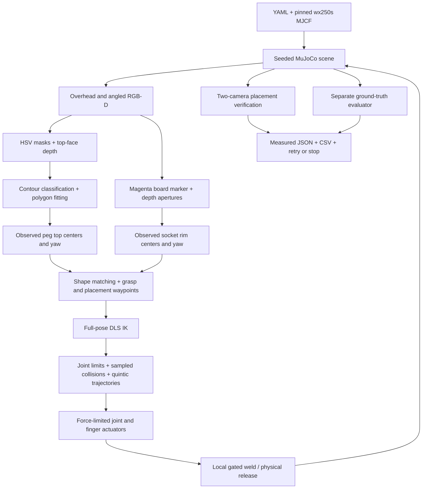

# Architecture

The perception modules accept only rendered arrays and camera calibration. They do not access MuJoCo object bodies or socket sites. Peg top poses come from color-masked metric depth; socket rim poses come from a detected board and aperture boundaries. The apparent aperture boundary is projected to the observed rim plane rather than the recessed floor, avoiding perspective bias.

The overhead image uses OpenCV pixel coordinates. Intrinsic principal points are `(width-1)/2, (height-1)/2`. The camera-to-world transform includes `diag(1,-1,-1)` to convert OpenCV to MuJoCo camera axes. The pinned high-level renderer already converts raw depth and flips image rows. All task-space coordinates are meters; joint angles are radians.

`InverseKinematics` operates on a separate `MjData`, computes `mj_jacSite`, and minimizes a weighted six-dimensional pose error with damping, bounded updates, restarts, and joint clipping. Success always checks both the position and orientation residual. Configuration validation rejects malformed rotations and nonfinite inputs.

`TrajectoryPlanner` checks sampled robot configurations and the estimated carried-object pose on another scratch `MjData`. Scratch object pose assignment is necessary for collision prediction and does not change the live simulator. The fixed robot base/table mounting pair and intended gripper/target contacts are exempt; table, board, other pegs, self collisions, and carried-object collisions are checked. A 0.7 mm numerical penetration tolerance is used. Sampling is conservative but cannot prove continuous collision freedom.

The live controller writes actuator targets only. Bias-force compensation counteracts model gravity/dynamics while force-limited position servos track quintic joint targets. Fine Cartesian waypoints define the approach and insertion; each approach is checked before execution. The gripper closes physically and activates an equality weld only after local geometry, distance, aperture, uprightness, and velocity checks. The current relative pose is recorded, so attachment does not snap the object to a new pose.

Ground truth is isolated to evaluation, grasp capture gating, and collision geometry. Initial pose errors are evaluated by spatial assignment to simulated bodies. Placement additionally checks released equality state, true insertion depth, XY alignment, symmetry-aware yaw, uprightness, linear/angular velocity, and a position stability window. Both camera observations must independently confirm seated top height. A final physical check catches any earlier peg that shifted later.

The state sequence is observe → match → validate targets → pregrasp → approach → settle → close/attach → lift → transfer/rotate → lower → release → retreat → park → verify. There is one bounded retry after safe release or a recoverable no-object failure. A failure while carrying an object stops further actions for recovery. The console and JSON retain the reason.
